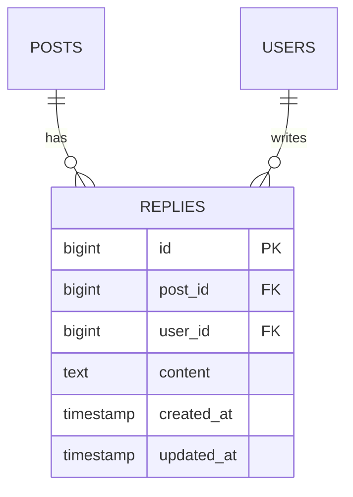

# 概要

ログイン中の利用者がポスト詳細画面でリプライを読み書きできるようにする。投稿者と投稿日時をリプライごとに表示し、削除は作成者本人に限る。本文を送信すると詳細画面へ戻り、一覧に反映する。

# 受け入れ条件

- ログイン中の利用者がポストを開くと、対象ポストとそのリプライ一覧が表示される。
- 本文を入力して送信すると、リプライが保存され、一覧に追加される。
- 本文が空のまま送信された場合は日本語のエラーを表示し、リプライを追加しない。
- 作成者本人は自分のリプライを削除できる。他人のリプライは削除できない。
- リプライ削除時に確認画面を挟まず、その場で削除する。
- タイムラインの一覧・編集・削除の既存動作と既存の投稿ルートを維持する。

# 変えないもの

- 認証を必須とし、投稿者はログイン中の利用者とする。
- ポストの既存データ構造、タイムラインの一覧・編集・削除の動作を変更しない。
- 投稿編集・削除は既存の `PostPolicy` による認可を維持する。
- 本機能ではポスト本文やカテゴリの入力条件を変更しない。

# 増えるテーブル

リプライを `replies` テーブルに保存する。ポストまたは利用者が削除された場合、そのポストのリプライまたは利用者のリプライも削除する。

- `post_id` は `posts.id` を参照し、ポスト削除時に連動して削除する。
- `user_id` は `users.id` を参照し、利用者削除時に連動して削除する。
- `content` はリプライ本文を保持する。作成者と作成日時を合わせて一覧に表示する。

# 増える画面

ポスト詳細画面を追加する。タイムラインのポストタイトルから開き、選んだポストのタイトル・投稿者・カテゴリ・日時・本文を表示する。画面内にリプライ作成欄とリプライ一覧を置き、各リプライに投稿者名・日時・本文を表示する。

- 詳細画面、リプライ作成、リプライ削除はログイン中の利用者だけが利用できる。
- リプライの削除操作は作成者本人にだけ表示し、実行時もサーバー側で所有者を認可する。
- 削除確認画面は設けない。削除後は該当ポストの詳細画面に戻る。
- リプライがない場合は空の一覧に代わる案内を表示する。

# 入力チェックとメッセージ一覧

リプライ本文は必須の文字列とし、既存のポスト本文上限に揃えて140文字以内とする。入力エラー時は保存せず、詳細画面に戻って該当欄の近くに日本語メッセージを表示する。

| 項目 | チェック | エラー時のメッセージ |
| --- | --- | --- |
| リプライ本文 | 必須 | リプライ本文を入力してください。 |
| リプライ本文 | 文字列 | リプライ本文は文字列で入力してください。 |
| リプライ本文 | 140文字以内 | リプライ本文は140字以内で入力してください。 |

# テスト観点

- ログイン済み利用者がポスト詳細を開き、ポストとリプライ一覧を確認できる。
- リプライがない場合の案内と、既存リプライがある場合の本文・投稿者・日時を確認できる。
- 有効な本文を送信するとリプライが1件増え、表示内容と作成者が正しい。
- 本文が空の場合、日本語エラーが表示され、リプライ件数が変わらない。
- 140文字の本文は受理し、141文字の本文は拒否する。
- 自分のリプライを確認画面なしで削除でき、一覧から消える。
- 他人のリプライには削除操作が表示されず、サーバー側の認可でも削除できない。
- 既存のタイムライン一覧、投稿編集、投稿削除が従来どおり動作する。
